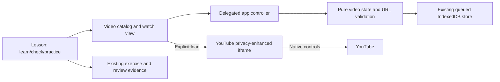

# PRD: Guided learning and YouTube library

Date: 2026-11-09 (Asia/Makassar). Status: APPROVED by user: "Approve PRD and implement".

## Intent and user decisions

Extend DSA Journey so a learner can study, check understanding, practice, and watch relevant YouTube videos inside the app. The user explicitly chose both curated lesson videos and personal YouTube links, integrated into the existing local-first learning app. The initial request authorizes research, a PRD, and subsequent implementation. Existing Indonesian lessons and Python/C++ exercises remain the foundation.

Success means the learner can find the next learning action, optionally watch a relevant video, return to the related exercise, and recover personal video notes/bookmarks after reload or backup restore. Watching is supplementary activity, never proof of correctness or mastery.

## Current architecture and constraints

The application is dependency-free browser ES modules served by Node. `views.js` renders lessons and navigation; `app.js` handles delegated events, navigation and serialized persistence; `core.js` owns evidence and backup validation; `storage.js` writes the state atomically to IndexedDB. Content lives in four JSON batches. The isolated Python runner and local sandboxed C++ provider are separate execution adapters. A custom builder packages the same modules into a standalone HTML artifact.

Preserve the 28-module/112-lesson/180-activity curriculum, stable IDs, code drafts, exposure history, content versions, review scheduling and all existing safeguards. Do not change runtime/compiler behavior. No paid service, API key, account, cloud sync or new package is required.

## Research and resulting choices

1. [IES practice guide](https://ies.ed.gov/ncee/wwc/PracticeGuide/1): spacing and alternating worked examples with problem solving have moderate evidence in this guide; quiz re-exposure and deep explanatory questions have strong evidence. Application choice: expose Learn → Check → Practice → Review actions, keep worked examples and checkpoint feedback, and retain the existing delayed-review system. These findings are not an evaluation of this specific DSA app.
2. [Microsoft architectural principles](https://learn.microsoft.com/dotnet/standard/modern-web-apps-azure-architecture/architectural-principles): separate concerns and protect domain state behind explicit interfaces. Application inference: retain modular layers, add pure video URL/state operations and a separate video view, and reuse the storage boundary. The source is .NET guidance; this adaptation uses plain JavaScript, not a framework migration.
3. [MDN JavaScript modules](https://developer.mozilla.org/en-US/docs/Web/JavaScript/Guide/Modules): modules provide explicit imports/exports. Keep the existing ESM deployment and extend the standalone module list for new modules.
4. [YouTube embed parameters](https://developers.google.com/youtube/player_parameters): standard iframe embedding needs no Data API search service. Minimum player viewport is 200 × 200; preserve native controls, keyboard behavior and fullscreen. Use a responsive player, no autoplay, and a minimum height of 200px.
5. [YouTube privacy-enhanced mode](https://support.google.com/youtube/answer/171780): use `youtube-nocookie.com`; this limits personalization but is not a promise of zero third-party traffic. Load the player only after explicit activation; render no remote thumbnail before activation.
6. [YouTube errors](https://developers.google.com/youtube/iframe_api_reference#onError): videos can be private, removed or non-embeddable, and missing referrer can cause error 153. Always provide an external YouTube link; support playback over HTTP localhost/HTTPS. On `file:` display the limitation and external fallback rather than imply reliable in-app playback. Do not report iframe `load` as successful video playback.
7. Primary curated sources: [CS50P functions/variables](https://cs50.harvard.edu/python/weeks/0/), [conditionals](https://cs50.harvard.edu/python/weeks/1/), [loops](https://cs50.harvard.edu/python/weeks/2/), and [MIT 6.006 lectures](https://ocw.mit.edu/courses/6-006-introduction-to-algorithms-spring-2020/video_galleries/lecture-videos/). Use publisher-linked video IDs and attribution. Metadata/source links are checked during research; playback availability must be tested separately. Do not reproduce transcripts or claim a video covers every lesson.

## Approaches

| Approach | Benefit | Cost | Decision |
| --- | --- | --- | --- |
| Integrated local-first learning and video library | Relevant videos beside lessons; personal resources and learning actions share navigation and storage | Requires URL validation, backup validation and controlled embed lifecycle | User selected |
| Separate video page with minimal lesson changes | Small implementation | Weak relationship to practice and curriculum | Not selected |
| Cloud-backed video platform | Cross-device management and dynamic search possible | Authentication, operations, privacy and possible API costs | Not selected |

## Product requirements

| ID | Behavior and acceptance |
| --- | --- |
| LV-01 | Every lesson shows a compact Learn → Check → Practice → Review guide. Check links to the lesson checkpoint, Practice to the first associated exercise (or module fallback), Review to the existing queue. Show completion/checkpoint status without claiming mastery. |
| LV-02 | Lessons with curated or user-linked videos show title, publisher, language, relevance/prompt and an in-app watch link. Other lessons show an honest empty state and an add-link entry point. Initial curation is a small verified seed set, not a claim of all-lesson coverage. |
| LV-03 | Add Video library to primary navigation. Search title/publisher, filter curated/personal and optionally lesson; show meaningful empty/reset states. Curated items link back to related lessons and practice. |
| LV-04 | Add a personal video with required title and YouTube URL and optional lesson association. Accept standard HTTPS watch, youtu.be, embed, shorts and live URLs only on exact supported YouTube hosts. Reject credentials, other protocols/hosts and malformed IDs. Store only the normalized 11-character ID and bounded metadata, never raw embed HTML. |
| LV-05 | Selecting a video opens a dedicated watch view. An explicit Load video button mounts one privacy-enhanced iframe. No autoplay or background playback; Unload and route changes remove it. All source/network failures retain the external link and saved notes; native YouTube error UI is allowed. |
| LV-06 | Save a reflection note, manually entered resume time (seconds), and a self-reported watched checkbox for curated and personal videos. Display that progress is self-reported. Starting again uses the saved timestamp. Save via the existing persistence queue and retain inputs on validation failure. Do not infer actual watch time or completion from iframe events. |
| LV-07 | Delete personal links with the app's existing confirmation convention; curated resources cannot be deleted. Removing a personal link also removes its personal video note/bookmark, after confirmation. Video metadata and progress do not create exercise attempts, checkpoint passes, completion or mastery evidence. |
| LV-08 | Reload, export/import and old backups work. Add optional `videos` and `videoProgress` fields within schema 1; old backups default them to empty collections. Strictly validate all new fields before replacement; reject malformed entries and duplicate IDs. Preserve existing progress/exposure recovery. |
| LV-09 | Native labelled inputs, keyboard-visible focus, live save feedback, iframe title, responsive desktop/mobile layouts and minimum player dimensions. Keep reading and practice usable without YouTube/network. |

## Design and responsibilities

Use an MVC-like flow already present in the app: delegated controller actions → pure state transformation → queued storage → view. Single responsibility: a video domain module normalizes URLs, validates video records and manages video progress; a video view module renders catalog/watch/lesson resources; the controller handles DOM activation and saves. Repository/storage pattern: reuse `openStore`, not a parallel localStorage database. Adapter boundary: generate only a fixed YouTube embed URL from a validated ID, keeping vendor behavior outside mastery logic. Prefer functions and plain records over speculative classes, dependency injection containers or microservices.

Data flow:

Builder choices: `dist/videos.js` contains seed metadata and pure model functions; `dist/views-video.js` contains rendering; extend `views.js`, `app.js`, `styles.css`, `core.js`, `server.mjs`, tests and standalone builder. Keep curated metadata in an exported static array so both server and standalone can consume it without an extra request. Keep schema 1 because this is an additive optional extension, with validation and legacy-backup tests. No database migration is necessary.

Personal record: `{id, videoId, title, publisher, lessonId, addedAt}`. IDs use a distinct user prefix; bounded title/publisher fields and valid optional lesson association. Video progress map keyed by resource ID: `{notes, resumeSeconds, watched, updatedAt}`; timestamp and seconds must be finite and bounded (resume 0–86400; notes at most 10000 characters). Cap personal resources and progress entries at 500. Curated keys remain stable. On import, preserve valid historical lesson associations visibly as unavailable if content is absent; never turn them into evidence. Reject unknown progress keys that match neither curated nor imported personal records.

Only allow `https://www.youtube-nocookie.com` in the server's `frame-src` in addition to existing self frames. Do not broaden script/connect sources or expose runner data to YouTube. Set iframe referrer policy to `strict-origin-when-cross-origin`; do not use `no-referrer`. Embed permission includes fullscreen and picture-in-picture; no autoplay. Do not add IFrame API loading for manual bookmarks. A full app rerender can unload a player; background C++ status should not unexpectedly interrupt an already mounted watch view. Scope player activation to the current route and clear it on navigation.

## Non-goals and failure conditions

No YouTube search API, download, ad removal, transcript scraping, automatic watch tracking, video hosting, recommendations algorithm or all-curriculum video coverage. Do not copy creators' course content into the authored curriculum. No new mastery thresholds. A failed embed is not a failed exercise. Losing saved notes, introducing arbitrary iframe origins, granting mastery from watched flags, or making lessons depend on YouTube are release blockers.

## Verification and delivery

Write failing behavioral tests first for URL allowlisting, personal records, bookmark validation, legacy/new backup round trips and evidence isolation; implement and run them. View/controller tests cover navigation, escaping, click-to-load, unload, personal CRUD, search/filter and links to practice. Test server CSP explicitly and rebuild standalone HTML. Run the complete existing Node suite and content validator; do not rerun unrelated full compiler validation unless compiler behavior changes.

Browser QA on a fresh isolated browser context: add/reload/watch/unload/edit notes/bookmark/delete, restore a backup, lesson → video → practice, desktop/mobile overflow, and fallback behavior. Check actual YouTube playback when network permits; report blocked playback separately from verified UI/iframe lifecycle. Inspect desktop/mobile screenshots. Record exact verification and limits in a dated report and the progress ledger. Do not claim learning efficacy or all-device accessibility from these checks.

## Open approval

The user approved this written PRD and requested implementation on 2026-11-09. Builder check found no material open questions. Implementation proceeds in this scope.
